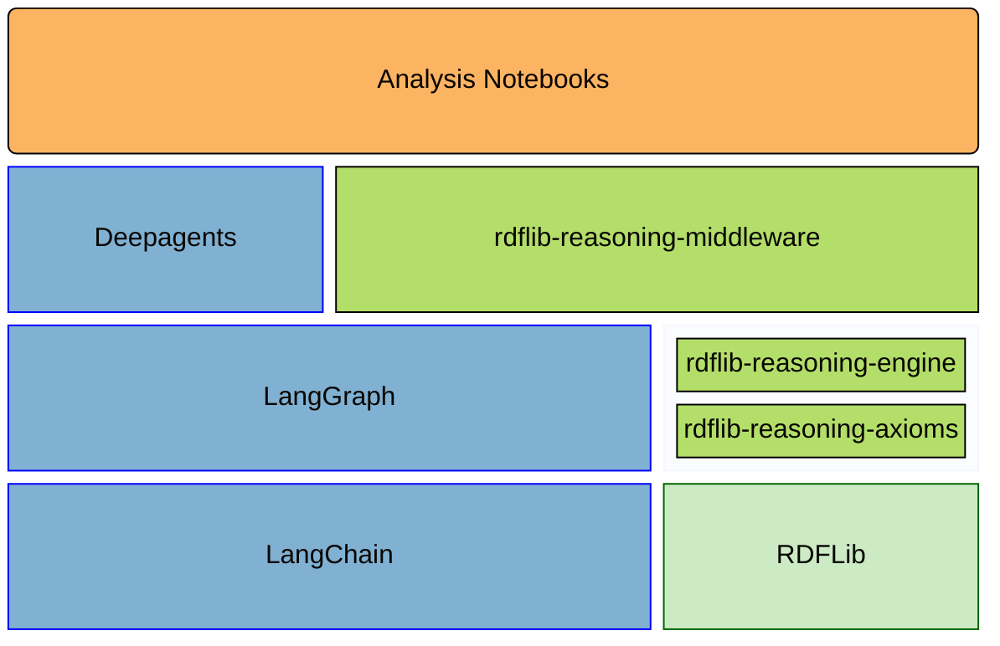

# rdflib-reasoning

[](https://opensource.org/licenses/MIT)
[](https://www.repostatus.org/#active)

[](https://pypi.org/project/rdflib-reasoning/)

[](https://kvjrhall.github.io/rdflib-reasoning/)

[](https://github.com/kvjrhall/rdflib-reasoning/tree/python-coverage-comment-action-data)

`rdflib-reasoning` is a family of Python packages for RDFLib graph
axiomatization, RETE-based RDFS and OWL 2 RL entailment, support-aware
retraction, inspectable proofs, contradiction diagnostics, and semantic-web
middleware.

The packages are designed for ordinary RDFLib use first, while also supporting
research into tool-grounded Research Agents that reason over RDF graphs and
formal logic systems.

## Installation

Install the published metapackage:

```sh
pip install rdflib-reasoning
```

That install pulls in the repository's published component packages:

- `rdflib-reasoning`
- `rdflib-reasoning-axioms`
- `rdflib-reasoning-engine`
- `rdflib-reasoning-middleware`

If you only need part of the system, you can also install the component
packages directly from PyPI.

## Quickstart

The basic RDFS inference path uses an ordinary RDFLib dataset backed by the
reasoning store:

```python
from rdflib import Namespace
from rdflib.namespace import RDF, RDFS
from rdflib_reasoning.engine import RDFS_RETE_MATERIALIZED

EX = Namespace("urn:example:")

dataset = RDFS_RETE_MATERIALIZED.dataset()
graph = dataset.default_graph

alice = EX.alice
person = EX.Person
mammal = EX.Mammal
animal = EX.Animal

graph.add((alice, RDF.type, person))
graph.add((person, RDFS.subClassOf, mammal))
graph.add((mammal, RDFS.subClassOf, animal))

assert (alice, RDF.type, animal) in graph
```

Because the reasoning store is wired through ordinary RDFLib graph events,
statement retraction uses the normal `graph.remove(...)` API:

```python
graph.remove((alice, RDF.type, person))

assert (alice, RDF.type, animal) not in graph
```

Contradiction detection is also available through the same engine path: extend
a reasoner specification with the appropriate contradiction rules, and the
default recorder records the diagnostic before raising
`ContradictionDetectedError`.

## Component Packages

| Package | Purpose |
| --- | --- |
| `rdflib-reasoning` | Metapackage for the published library family |
| `rdflib-reasoning-axioms` | Graph axiomatization primitives |
| `rdflib-reasoning-engine` | RETE-based RDFS and OWL 2 RL entailment |
| `rdflib-reasoning-middleware` | Semantic-web middleware and Research Agent-facing data interchange |

## Repository Layout

| Path | Purpose |
| --- | --- |
| [notebooks](./notebooks/) | Analysis notebooks and research experiments |
| [rdflib-reasoning-axioms](./rdflib-reasoning-axioms/) | Graph axiomatization primitives |
| [rdflib-reasoning-engine](./rdflib-reasoning-engine/) | RETE-based RDFS and OWL 2 RL entailment |
| [rdflib-reasoning-middleware](./rdflib-reasoning-middleware/) | Middleware and Research Agent-facing data interchange |
| [docs/dev](./docs/dev/) | Architecture notes, decision records, and development guidance |
| [docs/specs](./docs/specs/) | Cached specifications optimized for development work |

API and developer documentation is published at
[rdflib-reasoning documentation](https://kvjrhall.github.io/rdflib-reasoning/).
It can also be generated locally with `make docs` and served with
`make docs-serve`.

## Examples And Notebooks

The checked-in notebooks provide tutorial paths, demonstrations, and research
experiments:

- [notebooks/demo-rdfs-inference.ipynb](./notebooks/demo-rdfs-inference.ipynb):
  shortest end-to-end walkthrough of RDFLib-backed RDFS materialization plus a
  proof view showing which rule applications justify one inferred triple
- [notebooks/demo-owl2-rl-inference.ipynb](./notebooks/demo-owl2-rl-inference.ipynb):
  OWL 2 RL counterpart showing class-equivalence and subclass typing
  materialization plus proof inspection for one inferred triple
- [notebooks/demo-rdfs-retraction.ipynb](./notebooks/demo-rdfs-retraction.ipynb):
  update-aware companion showing that ordinary statement removal retracts
  dependent RDFS inferences
- [notebooks/demo-contradiction-rules.ipynb](./notebooks/demo-contradiction-rules.ipynb):
  OWL 2 RL contradiction diagnostics when contradiction rules are included in
  the active ruleset
- [notebooks/demo-proof-reconstructor.ipynb](./notebooks/demo-proof-reconstructor.ipynb):
  proof-focused companion notebook covering Mermaid rendering, markdown
  rendering, and raw `DirectProof` inspection
- [notebooks/README.md](./notebooks/README.md): notebook index with suggested
  reading order for demos and experiments

## Research And Evaluation

The repository also supports one practical research question:

> When do tool-grounded Research Agent harnesses outperform direct prompting on
> multi-step formal reasoning tasks that require external knowledge retrieval,
> knowledge-base updates, and verifiable inference?

Research on agents takes place in [Analysis Notebooks](./notebooks/), uses the
[LangChain ecosystem](https://www.langchain.com/), and depends on packages
defined in this repository. Those packages build on
[RDFLib](https://github.com/RDFLib/rdflib) for semantic-web support and on
[Pydantic](https://docs.pydantic.dev/latest/) for Research Agent-friendly
schemas.



## Reviewer Guide

For agent-assisted review, use the project critique skill at
[.cursor/skills/critique-project/SKILL.md](.cursor/skills/critique-project/SKILL.md).
If your tool does not discover `.cursor` skills automatically, open the skill
file and ask your coding agent to follow it. For manual review, start here:

1. Read this file for the package purpose, install path, and repository layout.
2. Read [docs/dev/architecture.md](./docs/dev/architecture.md) for the current
   technical direction.
3. Inspect [rdflib-reasoning-engine](./rdflib-reasoning-engine/) for the
   reasoning core.
4. Inspect [rdflib-reasoning-middleware](./rdflib-reasoning-middleware/) for
   Research Agent integration.
5. Inspect [notebooks](./notebooks/) for the research surface and experiments.

## Repository Roles

This repository distinguishes between two agent types. Canonical definitions are
in [AGENTS.md](./AGENTS.md).

- **Research Agent**: The deployed or runtime agent that is the subject of
  research. It sees middleware, tools, system prompts, and generated schema; it
  does not see the repository or design documentation.
- **Development Agent**: The code agent that reads repository documentation,
  modifies code and docs, and develops code for the Research Agent.

## Contributing

For local development setup, validation commands, notebook contribution
guidance, and publishing policy, see
[.github/CONTRIBUTING.md](.github/CONTRIBUTING.md).

If you are using these packages from another project, install the published
packages from PyPI and start with the
[published documentation](https://kvjrhall.github.io/rdflib-reasoning/).
Use the monorepo checkout when you need to modify package code, contribute
notebooks, or inspect unpublished changes.

## Why This Repository Exists

RDFLib does not by itself provide a clean path for graph axiomatization,
support-aware entailment, Research Agent-oriented schema exposure, and
inspectable reasoning workflows. This repository packages those concerns into
reusable libraries so Python projects can build on dependable semantic-web
reasoning infrastructure, while the included notebooks show how that
infrastructure supports formal-logic experiments with agents.
