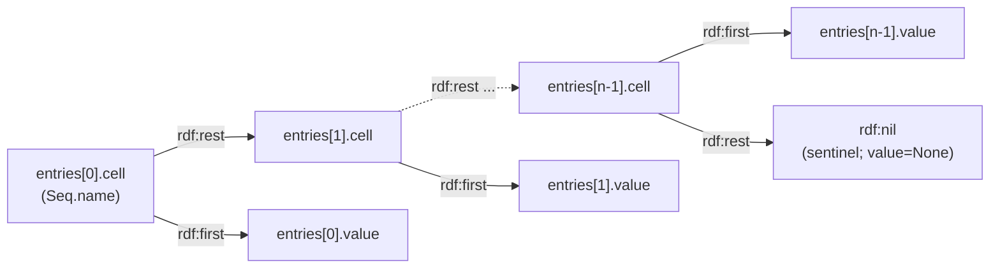

# RDFLib Reasoning Axioms

Agentic AI should be able to interface with formal logic.

Some formal logics (i.e., OWL 2) have a mapping from their axioms to RDF triples.
Unfortunately, one needs to refer to [OWL 2 Web Ontology Language Mapping to RDF Graphs (Second Edition)](https://www.w3.org/TR/2012/REC-owl2-mapping-to-rdf-20121211/) if they want to extract axioms while working with RDFLib.
In my opinion, models should not be constrained to operate at the triple-level when using ontological data.
The `rdflib-reasoning-axioms` package facilitates axiom-based graph traversals for Large Language Models (LLMs), Graph Neural Networks (GNNs), and other ML approaches.

The `rdflib-reasoning-axioms` package is part of the `rdflib-reasoning` metapackage.

## Feature Matrix

Status values:

- `Implemented`: available in the package today
- `Not started`: identified feature target with no concrete structural element implementation yet

The authoritative reference for this matrix is the local cached specification index at [`docs/specs/owl2-mapping-to-rdf/INDEX.md`](../docs/specs/owl2-mapping-to-rdf/INDEX.md).

### Core infrastructure

| Feature | Spec reference | Status | Notes |
| --- | --- | --- | --- |
| `GraphBacked` base model | package base infrastructure | Implemented | Common graph-scoped base for Pydantic models |
| `StructuralElement` base model | package base infrastructure | Implemented | Abstract OWL 2 structural element (axiom head) base with `name`, `as_triples`, and `as_quads`; enforces shared `context` for owned `StructuralFragment` fields |
| `StructuralFragment` base model | package base infrastructure | Implemented | Abstract base for owned scaffolding co-essential to a single `StructuralElement`'s RDF mapping; shares the owner's `context` |
| `SEQ` / RDF list helper | `SEQ` | Implemented | `Seq` (a `StructuralFragment`) plus `SeqEntry`: RDF list scaffolding with node-level `rdf:first` members |
| Facet list helper | (extension; supports `DatatypeRestriction`) | Implemented | `FacetList` (a `StructuralFragment`) plus `FacetEntry`: per-row `(cell, anchor, facet, value)` carrying both the cons-cell chain and the per-facet anchor triple |
| `axiomatize` graph traversal | RDF graph to structural elements | Implemented | Strict graph lifting for all Implemented feature-matrix forms below; unsupported or unclaimed triples fail the whole traversal |

#### Seq layout

`Seq` exposes its RDF cons-cell chain as a flat `entries: Sequence[SeqEntry]`; each `SeqEntry` pairs the cell node with its `rdf:first` value. The terminal sentinel row uses `cell == rdf:nil` and `value is None` and emits no `rdf:first` triple.

### Ontology header and declarations

| Feature | Spec reference | Status | Notes |
| --- | --- | --- | --- |
| Ontology header | `Ontology`, `imports`, `version` | Not started | |
| Datatype declaration | `DeclarationDatatype` | Implemented | `axiomatize` constructs this fallback for remaining `(DT, rdf:type, rdfs:Datatype)` triples not consumed by richer datatype patterns |
| Class declaration | `DeclarationClass` | Implemented | `axiomatize` constructs this fallback for remaining `(C, rdf:type, owl:Class)` triples |
| Object property declaration | `DeclarationObjectProperty` | Implemented | `axiomatize` constructs this fallback for remaining `(OP, rdf:type, owl:ObjectProperty)` triples |
| Data property declaration | `DeclarationDataProperty` | Implemented | `axiomatize` constructs this fallback for remaining `(DP, rdf:type, owl:DatatypeProperty)` triples |
| Annotation property declaration | `DeclarationAnnotationProperty` | Implemented | `axiomatize` constructs this fallback for remaining `(AP, rdf:type, owl:AnnotationProperty)` triples |
| Named individual declaration | `NamedIndividual` | Implemented | `axiomatize` constructs this for `(a, rdf:type, owl:NamedIndividual)` triples |

### Data ranges and class expressions

| Feature | Spec reference | Status | Notes |
| --- | --- | --- | --- |
| Object inverse | `ObjectInverseOf` | Implemented | Shallow `_:x owl:inverseOf OP` only (no `rdf:type`) |
| Data intersection | `DataIntersectionOf` | Implemented | Owned `Seq` operand list (n >= 2) |
| Data union | `DataUnionOf` | Implemented | Owned `Seq` operand list (n >= 2) |
| Data complement | `DataComplementOf` | Implemented | Cross-axiom operand via `N3Resource` node reference |
| Data enumeration | `DataOneOf` | Implemented | Owned `Seq` operand list of literals (n >= 1) |
| Datatype restriction | `DatatypeRestriction` | Implemented | Owned `FacetList` carrying per-facet anchor, predicate, and value |
| Object intersection | `ObjectIntersectionOf` | Implemented | Owned `Seq` operand list (n >= 2); `owl:Class` |
| Object union | `ObjectUnionOf` | Implemented | Owned `Seq` operand list (n >= 2); `owl:Class` |
| Object complement | `ObjectComplementOf` | Implemented | Cross-axiom operand via `N3Resource` node reference; `owl:Class` |
| Object enumeration | `ObjectOneOf` | Implemented | Owned `Seq` of individual resources (n >= 1); `owl:Class` |
| Object existential restriction | `ObjectSomeValuesFrom` | Implemented | Ambiguous with data form; axiomatize uses object-property typing |
| Object universal restriction | `ObjectAllValuesFrom` | Implemented | Ambiguous with data form; axiomatize uses object-property typing |
| Object value restriction | `ObjectHasValue` | Implemented | `owl:hasValue` individual (resource) |
| Object self restriction | `ObjectHasSelf` | Implemented | `owl:hasSelf "true"^^xsd:boolean` |
| Object min cardinality | `ObjectMinCardinality`, `ObjectMinCardinalityQualified` | Implemented | Qualified uses `owl:onClass`; unqualified needs object-property typing |
| Object max cardinality | `ObjectMaxCardinality`, `ObjectMaxCardinalityQualified` | Implemented | Qualified uses `owl:onClass`; unqualified needs object-property typing |
| Object exact cardinality | `ObjectExactCardinality`, `ObjectExactCardinalityQualified` | Implemented | Qualified uses `owl:onClass`; unqualified needs object-property typing |
| Data existential restriction | `DataSomeValuesFrom`, `DataSomeValuesFromNary` | Implemented | Both unary and n-ary (n >= 2) forms |
| Data universal restriction | `DataAllValuesFrom`, `DataAllValuesFromNary` | Implemented | Both unary and n-ary (n >= 2) forms |
| Data value restriction | `DataHasValue` | Implemented | `owl:hasValue` literal |
| Data min cardinality | `DataMinCardinality`, `DataMinCardinalityQualified` | Implemented | Qualified uses `owl:onDataRange` |
| Data max cardinality | `DataMaxCardinality`, `DataMaxCardinalityQualified` | Implemented | Qualified uses `owl:onDataRange` |
| Data exact cardinality | `DataExactCardinality`, `DataExactCardinalityQualified` | Implemented | Qualified uses `owl:onDataRange` |

#### Graph traversal coverage

`axiomatize(graph)` lifts supported RDF graph content into a deterministic
`tuple[StructuralElement, ...]`. Currently supported forms (aligned with
Implemented rows in this matrix / parsers in `axiomatize`):

- Declarations and individuals: `DeclarationDatatype`, `DeclarationClass`,
  `DeclarationObjectProperty`, `DeclarationDataProperty`,
  `DeclarationAnnotationProperty`, `NamedIndividual`
- Data ranges: `DataIntersectionOf`, `DataUnionOf`, `DataComplementOf`,
  `DataOneOf`, `DatatypeRestriction`
- Object / class expressions: `ObjectIntersectionOf`, `ObjectUnionOf`,
  `ObjectComplementOf`, `ObjectOneOf`, `ObjectInverseOf` (blank-node
  `owl:inverseOf` only)
- Object restrictions: `ObjectSomeValuesFrom`, `ObjectAllValuesFrom`,
  `ObjectHasValue`, `ObjectHasSelf`, unqualified and qualified
  `ObjectMinCardinality` / `ObjectMaxCardinality` / `ObjectExactCardinality`
- Data restrictions: unary and n-ary `DataSomeValuesFrom` /
  `DataAllValuesFrom`, `DataHasValue`, unqualified and qualified
  `DataMinCardinality` / `DataMaxCardinality` / `DataExactCardinality`
- Class axioms: `SubClassOf`, binary `DisjointClasses`, binary
  `EquivalentClasses`, n-ary `DisjointClassesNary`, `DisjointUnion`
- Object property axioms: `SubObjectPropertyOf`, `SubObjectPropertyOfChain`,
  binary / n-ary `DisjointObjectProperties`, binary
  `EquivalentObjectProperties`, `ObjectPropertyDomain`,
  `ObjectPropertyRange`, `InverseObjectProperties` (IRI-subject
  `owl:inverseOf`)
- Object property characteristics: `FunctionalObjectProperty`,
  `InverseFunctionalObjectProperty`, `ReflexiveObjectProperty`,
  `IrreflexiveObjectProperty`, `SymmetricObjectProperty`,
  `AsymmetricObjectProperty`, `TransitiveObjectProperty`
- Data property axioms: `SubDataPropertyOf`, binary / n-ary
  `DisjointDataProperties`, binary `EquivalentDataProperties`,
  `DataPropertyDomain`, `DataPropertyRange`, `FunctionalDataProperty`,
  `DatatypeDefinition` (binary `owl:equivalentClass` with
  `rdfs:Datatype` tip)
- Keys and individuals: `HasKey`, binary `DifferentIndividuals`, n-ary
  `DifferentIndividualsNary` (`owl:members` only), binary `SameIndividual`

Ambiguous object/data shapes (restrictions and shared property predicates such
as `rdfs:subPropertyOf`, `rdfs:domain`, `rdfs:range`,
`owl:propertyDisjointWith`, `owl:equivalentProperty`, and
`owl:FunctionalProperty`) are disambiguated by co-occurring
`owl:DatatypeProperty` / object-property typing when present; untyped
properties default to the data-family parsers for restrictions and to the
object-family parsers for shared property axioms unless a
`owl:DatatypeProperty` tip is present. `FunctionalDataProperty` likewise
requires a `owl:DatatypeProperty` tip. `owl:equivalentClass` lifts as
`DatatypeDefinition` when the subject is typed `rdfs:Datatype`, otherwise as
binary `EquivalentClasses`.

Traversal is strict in this baseline. If any input triple cannot be claimed by a
currently supported pattern, `axiomatize` raises `UnsupportedGraphError`
instead of returning a partial structural view. If a recognized pattern is
present but malformed, such as a broken RDF list or invalid facet list,
`axiomatize` raises `MalformedGraphError`.

### Class axioms

| Feature | Spec reference | Status | Notes |
| --- | --- | --- | --- |
| Subclass axiom | `SubClassOf` | Implemented | |
| Equivalent classes | `EquivalentClasses` | Implemented | Binary only (`CE1 owl:equivalentClass CE2`); n-ary structural forms serialize to chains of binaries |
| Disjoint classes | `DisjointClasses`, `DisjointClassesNary` | Implemented | |
| Disjoint union | `DisjointUnion` | Implemented | |

### Object property axioms

| Feature | Spec reference | Status | Notes |
| --- | --- | --- | --- |
| Subobject property axiom | `SubObjectPropertyOf`, `SubObjectPropertyOfChain` | Implemented | Simple binary via `rdfs:subPropertyOf`; chain via owned `owl:propertyChainAxiom` Seq |
| Equivalent object properties | `EquivalentObjectProperties` | Implemented | Binary `owl:equivalentProperty` only (n-ary serializes to a chain) |
| Disjoint object properties | `DisjointObjectProperties`, `DisjointObjectPropertiesNary` | Implemented | Binary `owl:propertyDisjointWith`; n-ary `owl:AllDisjointProperties` + owned `owl:members` Seq |
| Object property domain | `ObjectPropertyDomain` | Implemented | Binary `rdfs:domain` |
| Object property range | `ObjectPropertyRange` | Implemented | Binary `rdfs:range` |
| Inverse object properties | `InverseObjectProperties` | Implemented | IRI-subject `owl:inverseOf`; blank-node subjects lift as `ObjectInverseOf` |
| Functional object property | `FunctionalObjectProperty` | Implemented | |
| Inverse-functional object property | `InverseFunctionalObjectProperty` | Implemented | |
| Reflexive object property | `ReflexiveObjectProperty` | Implemented | |
| Irreflexive object property | `IrreflexiveObjectProperty` | Implemented | |
| Symmetric object property | `SymmetricObjectProperty` | Implemented | |
| Asymmetric object property | `AsymmetricObjectProperty` | Implemented | |
| Transitive object property | `TransitiveObjectProperty` | Implemented | |

### Data property axioms

| Feature | Spec reference | Status | Notes |
| --- | --- | --- | --- |
| Subdata property axiom | `SubDataPropertyOf` | Implemented | Same RDF as object form; `axiomatize` prefers data when subject typed `owl:DatatypeProperty` |
| Equivalent data properties | `EquivalentDataProperties` | Implemented | Binary `owl:equivalentProperty`; needs `owl:DatatypeProperty` tip (else object form) |
| Disjoint data properties | `DisjointDataProperties`, `DisjointDataPropertiesNary` | Implemented | Same RDF as object forms; data preferred when properties typed `owl:DatatypeProperty` |
| Data property domain | `DataPropertyDomain` | Implemented | Same RDF as object form; data preferred with `owl:DatatypeProperty` tip |
| Data property range | `DataPropertyRange` | Implemented | Same RDF as object form; data preferred with `owl:DatatypeProperty` tip |
| Functional data property | `FunctionalDataProperty` | Implemented | |
| Datatype definition | `DatatypeDefinition` | Implemented | Binary `DT owl:equivalentClass DR`; preferred over `EquivalentClasses` when subject typed `rdfs:Datatype` |

### Keys, assertions, and annotations

| Feature | Spec reference | Status | Notes |
| --- | --- | --- | --- |
| Has-key axiom | `HasKey` | Implemented | Owned `owl:hasKey` Seq of property node refs |
| Same individual | `SameIndividual` | Implemented | Binary `owl:sameAs` only (n-ary serializes to a chain) |
| Different individuals | `DifferentIndividuals`, `DifferentIndividualsNary` | Implemented | Binary `owl:differentFrom`; n-ary `owl:AllDifferent` + `owl:members` (not `distinctMembers`) |
| Class assertion | `ClassAssertion` | Not started | |
| Object property assertion | `ObjectPropertyAssertion`, `ObjectPropertyAssertionInverseOf` | Not started | |
| Negative object property assertion | `NegativeObjectPropertyAssertion` | Not started | |
| Data property assertion | `DataPropertyAssertion` | Not started | |
| Negative data property assertion | `NegativeDataPropertyAssertion` | Not started | |
| Annotation assertion | `AnnotationAssertion` | Not started | |
| Subannotation property axiom | `SubAnnotationPropertyOf` | Not started | |
| Annotation property domain | `AnnotationPropertyDomain` | Not started | |
| Annotation property range | `AnnotationPropertyRange` | Not started | |
| Annotation value | `Annotation`, `AnnotationWithAnnotation` | Not started | |
| Annotated axioms | `AxiomAnnotationMainTriple`, `AxiomAnnotationMultipleTriple`, `AxiomAnnotationBlankNode` | Not started | |
