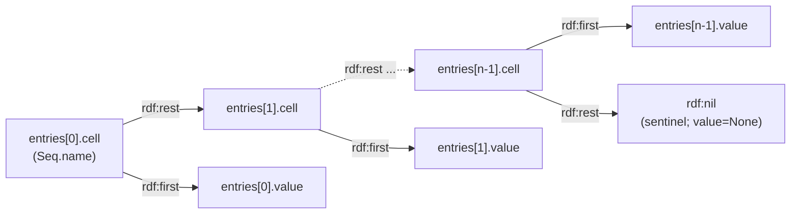

# RDFLib Reasoning Axioms

Agentic AI should be able to interface with formal logic.

Some formal logics (i.e., OWL 2) have a mapping from their axioms to RDF triples.
Unfortunately, one needs to refer to [OWL 2 Web Ontology Language Mapping to RDF Graphs (Second Edition)](https://www.w3.org/TR/2012/REC-owl2-mapping-to-rdf-20121211/) if they want to extract axioms while working with RDFLib.
In my opinion, models should not be constrained to operate at the triple-level when using ontological data.
The `rdflib-reasoning-axioms` package facilitates axiom-based graph traversals for Large Language Models (LLMs), Graph Neural Networks (GNNs), and other ML approaches.

The `rdflib-reasoning-axioms` package is part of the `rdflib-reasoning` metapackage.

## Feature Matrix

Status values:

- ✅ `Implemented`: available in the package today
- ⬜ `Not started`: identified feature target with no concrete structural element implementation yet

Column roles:

- **Axiomatization Notes**: package lifting / serialization behavior
- **Profile Notes**: OWL 2 RL exclusions or usage limits only (omit when the
  construct is used in RL without special limits). Package support can exceed
  RL; an Implemented row with a profile limit still lifts the broader OWL 2 RDF
  shape unless the axiomatization note says otherwise.

The authoritative reference for this matrix is the local cached specification index at [`docs/specs/owl2-mapping-to-rdf/INDEX.md`](../docs/specs/owl2-mapping-to-rdf/INDEX.md).
OWL 2 RL limits cite [`docs/specs/owl2-reasoning-profiles/optimized.html`](../docs/specs/owl2-reasoning-profiles/optimized.html) §4.1–4.2 (Table 2 and axiom grammar).

### Core infrastructure

| Feature | Spec reference | Status | Axiomatization Notes | Profile Notes |
| --- | --- | --- | --- | --- |
| `GraphBacked` base model | package base infrastructure | ✅ | Common graph-scoped base for Pydantic models | |
| `StructuralElement` base model | package base infrastructure | ✅ | Abstract OWL 2 structural element (axiom head) base with `name`, `as_triples`, and `as_quads`; enforces shared `context` for owned `StructuralFragment` fields | |
| `StructuralFragment` base model | package base infrastructure | ✅ | Abstract base for owned scaffolding co-essential to a single `StructuralElement`'s RDF mapping; shares the owner's `context` | |
| `SEQ` / RDF list helper | `SEQ` | ✅ | `Seq` (a `StructuralFragment`) plus `SeqEntry`: RDF list scaffolding with node-level `rdf:first` members | |
| Facet list helper | (extension; supports `DatatypeRestriction`) | ✅ | `FacetList` (a `StructuralFragment`) plus `FacetEntry`: per-row `(cell, anchor, facet, value)` carrying both the cons-cell chain and the per-facet anchor triple | |
| `axiomatize` graph traversal | RDF graph to structural elements | ✅ | Strict graph lifting for all Implemented feature-matrix forms below; unsupported or unclaimed triples fail the whole traversal | |

#### Seq layout

`Seq` exposes its RDF cons-cell chain as a flat `entries: Sequence[SeqEntry]`; each `SeqEntry` pairs the cell node with its `rdf:first` value. The terminal sentinel row uses `cell == rdf:nil` and `value is None` and emits no `rdf:first` triple.

### Ontology header and declarations

| Feature | Spec reference | Status | Axiomatization Notes | Profile Notes |
| --- | --- | --- | --- | --- |
| Ontology header | `Ontology`, `imports`, `version` | ⬜ | | Not part of OWL 2 RL/RDF rule premises |
| Datatype declaration | `DeclarationDatatype` | ✅ | `axiomatize` constructs this fallback for remaining `(DT, rdf:type, rdfs:Datatype)` triples not consumed by richer datatype patterns | |
| Class declaration | `DeclarationClass` | ✅ | `axiomatize` constructs this fallback for remaining `(C, rdf:type, owl:Class)` triples | |
| Object property declaration | `DeclarationObjectProperty` | ✅ | `axiomatize` constructs this fallback for remaining `(OP, rdf:type, owl:ObjectProperty)` triples | |
| Data property declaration | `DeclarationDataProperty` | ✅ | `axiomatize` constructs this fallback for remaining `(DP, rdf:type, owl:DatatypeProperty)` triples | |
| Annotation property declaration | `DeclarationAnnotationProperty` | ✅ | `axiomatize` constructs this fallback for remaining `(AP, rdf:type, owl:AnnotationProperty)` triples | Annotation axioms are outside OWL 2 RL entailment rules |
| Named individual declaration | `NamedIndividual` | ✅ | `axiomatize` constructs this for `(a, rdf:type, owl:NamedIndividual)` triples | |

### Data ranges and class expressions

| Feature | Spec reference | Status | Axiomatization Notes | Profile Notes |
| --- | --- | --- | --- | --- |
| Object inverse | `ObjectInverseOf` | ✅ | Shallow `_:x owl:inverseOf OP` only (no `rdf:type`) | |
| Data intersection | `DataIntersectionOf` | ✅ | Owned `Seq` operand list (n >= 2) | |
| Data union | `DataUnionOf` | ✅ | Owned `Seq` operand list (n >= 2) | Not an OWL 2 RL data-range constructor |
| Data complement | `DataComplementOf` | ✅ | Cross-axiom operand via `N3Resource` node reference | Not an OWL 2 RL data-range constructor |
| Data enumeration | `DataOneOf` | ✅ | Owned `Seq` operand list of literals (n >= 1) | Not an OWL 2 RL data-range constructor |
| Datatype restriction | `DatatypeRestriction` | ✅ | Owned `FacetList` carrying per-facet anchor, predicate, and value | Not an OWL 2 RL data-range constructor |
| Object intersection | `ObjectIntersectionOf` | ✅ | Owned `Seq` operand list (n >= 2); `owl:Class` | |
| Object union | `ObjectUnionOf` | ✅ | Owned `Seq` operand list (n >= 2); `owl:Class` | Subclass expressions only |
| Object complement | `ObjectComplementOf` | ✅ | Cross-axiom operand via `N3Resource` node reference; `owl:Class` | Superclass expressions only |
| Object enumeration | `ObjectOneOf` | ✅ | Owned `Seq` of individual resources (n >= 1); `owl:Class` | Subclass expressions only |
| Object existential restriction | `ObjectSomeValuesFrom` | ✅ | Ambiguous with data form; axiomatize uses object-property typing | Subclass expressions only |
| Object universal restriction | `ObjectAllValuesFrom` | ✅ | Ambiguous with data form; axiomatize uses object-property typing | Superclass expressions only |
| Object value restriction | `ObjectHasValue` | ✅ | `owl:hasValue` individual (resource) | |
| Object self restriction | `ObjectHasSelf` | ✅ | `owl:hasSelf "true"^^xsd:boolean` | Not used in OWL 2 RL class-expression positions |
| Object min cardinality | `ObjectMinCardinality`, `ObjectMinCardinalityQualified` | ✅ | Qualified uses `owl:onClass`; unqualified needs object-property typing | Not used in OWL 2 RL class-expression positions |
| Object max cardinality | `ObjectMaxCardinality`, `ObjectMaxCardinalityQualified` | ✅ | Qualified uses `owl:onClass`; unqualified needs object-property typing | Superclass side; cardinality 0 or 1 only |
| Object exact cardinality | `ObjectExactCardinality`, `ObjectExactCardinalityQualified` | ✅ | Qualified uses `owl:onClass`; unqualified needs object-property typing | Not used in OWL 2 RL class-expression positions |
| Data existential restriction | `DataSomeValuesFrom`, `DataSomeValuesFromNary` | ✅ | Both unary and n-ary (n >= 2) forms | Subclass expressions only (with RL data ranges) |
| Data universal restriction | `DataAllValuesFrom`, `DataAllValuesFromNary` | ✅ | Both unary and n-ary (n >= 2) forms | Superclass expressions only (with RL data ranges) |
| Data value restriction | `DataHasValue` | ✅ | `owl:hasValue` literal | |
| Data min cardinality | `DataMinCardinality`, `DataMinCardinalityQualified` | ✅ | Qualified uses `owl:onDataRange` | Not used in OWL 2 RL class-expression positions |
| Data max cardinality | `DataMaxCardinality`, `DataMaxCardinalityQualified` | ✅ | Qualified uses `owl:onDataRange` | Superclass side; cardinality 0 or 1 only |
| Data exact cardinality | `DataExactCardinality`, `DataExactCardinalityQualified` | ✅ | Qualified uses `owl:onDataRange` | Not used in OWL 2 RL class-expression positions |

#### Graph traversal coverage

`axiomatize(graph)` lifts supported RDF graph content into a deterministic
`tuple[StructuralElement, ...]`. Currently supported forms (aligned with
Implemented rows in this matrix / parsers in `axiomatize`):

- Declarations and individuals: `DeclarationDatatype`, `DeclarationClass`,
  `DeclarationObjectProperty`, `DeclarationDataProperty`,
  `DeclarationAnnotationProperty`, `NamedIndividual`
- Data ranges: `DataIntersectionOf`, `DataUnionOf`, `DataComplementOf`,
  `DataOneOf`, `DatatypeRestriction`
- Object / class expressions: `ObjectIntersectionOf`, `ObjectUnionOf`,
  `ObjectComplementOf`, `ObjectOneOf`, `ObjectInverseOf` (blank-node
  `owl:inverseOf` only)
- Object restrictions: `ObjectSomeValuesFrom`, `ObjectAllValuesFrom`,
  `ObjectHasValue`, `ObjectHasSelf`, unqualified and qualified
  `ObjectMinCardinality` / `ObjectMaxCardinality` / `ObjectExactCardinality`
- Data restrictions: unary and n-ary `DataSomeValuesFrom` /
  `DataAllValuesFrom`, `DataHasValue`, unqualified and qualified
  `DataMinCardinality` / `DataMaxCardinality` / `DataExactCardinality`
- Class axioms: `SubClassOf`, binary `DisjointClasses`, binary
  `EquivalentClasses`, n-ary `DisjointClassesNary`, `DisjointUnion`,
  `ClassAssertion` (only when the type object is a known CE)
- Object property axioms: `SubObjectPropertyOf`, `SubObjectPropertyOfChain`,
  binary / n-ary `DisjointObjectProperties`, binary
  `EquivalentObjectProperties`, `ObjectPropertyDomain`,
  `ObjectPropertyRange`, `InverseObjectProperties` (IRI-subject
  `owl:inverseOf`)
- Object property characteristics: `FunctionalObjectProperty`,
  `InverseFunctionalObjectProperty`, `ReflexiveObjectProperty`,
  `IrreflexiveObjectProperty`, `SymmetricObjectProperty`,
  `AsymmetricObjectProperty`, `TransitiveObjectProperty`
- Data property axioms: `SubDataPropertyOf`, binary / n-ary
  `DisjointDataProperties`, binary `EquivalentDataProperties`,
  `DataPropertyDomain`, `DataPropertyRange`, `FunctionalDataProperty`,
  `DatatypeDefinition` (binary `owl:equivalentClass` with
  `rdfs:Datatype` tip)
- Keys and individuals: `HasKey`, binary `DifferentIndividuals`, n-ary
  `DifferentIndividualsNary` (`owl:members`; also lifts legacy
  `owl:distinctMembers`), binary `SameIndividual`,
  `ClassAssertion` when the `rdf:type` object is a known class expression
  (declaration, parsed CE/restriction, CE operand, `owl:Thing` /
  `owl:Nothing`), `ObjectPropertyAssertion` when the predicate is a known
  object property and the object is a resource, `DataPropertyAssertion`
  when the predicate is a known data property and the object is a literal,
  `NegativeObjectPropertyAssertion` when an `owl:NegativePropertyAssertion`
  node uses `owl:targetIndividual` and a known object property,
  `NegativeDataPropertyAssertion` when an `owl:NegativePropertyAssertion`
  node uses `owl:targetValue` and a known data property

Ambiguous object/data shapes (restrictions and shared property predicates such
as `rdfs:subPropertyOf`, `rdfs:domain`, `rdfs:range`,
`owl:propertyDisjointWith`, `owl:equivalentProperty`, and
`owl:FunctionalProperty`) are disambiguated by co-occurring
`owl:DatatypeProperty` / object-property typing when present; untyped
properties default to the data-family parsers for restrictions and to the
object-family parsers for shared property axioms unless a
`owl:DatatypeProperty` tip is present. `FunctionalDataProperty` likewise
requires a `owl:DatatypeProperty` tip. `owl:equivalentClass` lifts as
`DatatypeDefinition` when the subject is typed `rdfs:Datatype`, otherwise as
binary `EquivalentClasses`.

Traversal is strict in this baseline. If any input triple cannot be claimed by a
currently supported pattern, `axiomatize` raises `UnsupportedGraphError`
instead of returning a partial structural view. If a recognized pattern is
present but malformed, such as a broken RDF list or invalid facet list,
`axiomatize` raises `MalformedGraphError`.

### Class axioms

| Feature | Spec reference | Status | Axiomatization Notes | Profile Notes |
| --- | --- | --- | --- | --- |
| Subclass axiom | `SubClassOf` | ✅ | | Subclass / superclass operands must obey Table 2 expression positions |
| Equivalent classes | `EquivalentClasses` | ✅ | Binary only (`CE1 owl:equivalentClass CE2`); n-ary structural forms serialize to chains of binaries | Operands must be `equivClassExpression` positions |
| Disjoint classes | `DisjointClasses`, `DisjointClassesNary` | ✅ | | Operands are subclass-side expressions |
| Disjoint union | `DisjointUnion` | ✅ | | Not supported in OWL 2 RL |

### Object property axioms

| Feature | Spec reference | Status | Axiomatization Notes | Profile Notes |
| --- | --- | --- | --- | --- |
| Subobject property axiom | `SubObjectPropertyOf`, `SubObjectPropertyOfChain` | ✅ | Simple binary via `rdfs:subPropertyOf`; chain via owned `owl:propertyChainAxiom` Seq | |
| Equivalent object properties | `EquivalentObjectProperties` | ✅ | Binary `owl:equivalentProperty` only (n-ary serializes to a chain) | |
| Disjoint object properties | `DisjointObjectProperties`, `DisjointObjectPropertiesNary` | ✅ | Binary `owl:propertyDisjointWith`; n-ary `owl:AllDisjointProperties` + owned `owl:members` Seq | |
| Object property domain | `ObjectPropertyDomain` | ✅ | Binary `rdfs:domain` | Class side is a superclass expression |
| Object property range | `ObjectPropertyRange` | ✅ | Binary `rdfs:range` | Class side is a superclass expression |
| Inverse object properties | `InverseObjectProperties` | ✅ | IRI-subject `owl:inverseOf`; blank-node subjects lift as `ObjectInverseOf` | |
| Functional object property | `FunctionalObjectProperty` | ✅ | | |
| Inverse-functional object property | `InverseFunctionalObjectProperty` | ✅ | | |
| Reflexive object property | `ReflexiveObjectProperty` | ✅ | | Not supported in OWL 2 RL |
| Irreflexive object property | `IrreflexiveObjectProperty` | ✅ | | |
| Symmetric object property | `SymmetricObjectProperty` | ✅ | | |
| Asymmetric object property | `AsymmetricObjectProperty` | ✅ | | |
| Transitive object property | `TransitiveObjectProperty` | ✅ | | |

### Data property axioms

| Feature | Spec reference | Status | Axiomatization Notes | Profile Notes |
| --- | --- | --- | --- | --- |
| Subdata property axiom | `SubDataPropertyOf` | ✅ | Same RDF as object form; `axiomatize` prefers data when subject typed `owl:DatatypeProperty` | |
| Equivalent data properties | `EquivalentDataProperties` | ✅ | Binary `owl:equivalentProperty`; needs `owl:DatatypeProperty` tip (else object form) | |
| Disjoint data properties | `DisjointDataProperties`, `DisjointDataPropertiesNary` | ✅ | Same RDF as object forms; data preferred when properties typed `owl:DatatypeProperty` | |
| Data property domain | `DataPropertyDomain` | ✅ | Same RDF as object form; data preferred with `owl:DatatypeProperty` tip | Class side is a superclass expression |
| Data property range | `DataPropertyRange` | ✅ | Same RDF as object form; data preferred with `owl:DatatypeProperty` tip | Data ranges are datatype / intersection only |
| Functional data property | `FunctionalDataProperty` | ✅ | | |
| Datatype definition | `DatatypeDefinition` | ✅ | Binary `DT owl:equivalentClass DR`; preferred over `EquivalentClasses` when subject typed `rdfs:Datatype` | |

### Keys, assertions, and annotations

| Feature | Spec reference | Status | Axiomatization Notes | Profile Notes |
| --- | --- | --- | --- | --- |
| Has-key axiom | `HasKey` | ✅ | Owned `owl:hasKey` Seq of property node refs | Class side is a subclass expression |
| Same individual | `SameIndividual` | ✅ | Binary `owl:sameAs` only (n-ary serializes to a chain) | |
| Different individuals | `DifferentIndividuals`, `DifferentIndividualsNary` | ✅ | Binary `owl:differentFrom`; n-ary `owl:AllDifferent` + `owl:members` (serialize); reverse also lifts OWL 1 legacy `owl:distinctMembers` and normalizes to `owl:members` | |
| Class assertion | `ClassAssertion` | ✅ | `a rdf:type CE` when `CE` is a known class expression; unknown type objects remain unconsumed | Class is a superclass expression |
| Object property assertion | `ObjectPropertyAssertion` | ✅ | `a1 OPE a2` when `OPE` is a known object property (incl. `ObjectInverseOf` BNode predicates); forward-mapping InverseOf individual-swap is not a distinct reverse element; unknown predicates / literals remain unconsumed | |
| Negative object property assertion | `NegativeObjectPropertyAssertion` | ✅ | Reified `owl:NegativePropertyAssertion` + `owl:targetIndividual` when `owl:assertionProperty` is a known OPE (incl. `ObjectInverseOf` BNodes); unknown OPEs / `owl:targetValue` remain for other parsers or unconsumed | |
| Data property assertion | `DataPropertyAssertion` | ✅ | `a DPE lt` when `DPE` is a known data property; unknown predicates / non-literals remain unconsumed | |
| Negative data property assertion | `NegativeDataPropertyAssertion` | ✅ | Reified `owl:NegativePropertyAssertion` + `owl:targetValue` when `owl:assertionProperty` is a known DPE; `owl:targetIndividual` claimed by object form; unknown DPEs remain unconsumed | |
| Annotation assertion | `AnnotationAssertion` | ⬜ | | Not used by OWL 2 RL/RDF entailment rules |
| Subannotation property axiom | `SubAnnotationPropertyOf` | ⬜ | | Outside OWL 2 RL completeness (Theorem PR1) |
| Annotation property domain | `AnnotationPropertyDomain` | ⬜ | | Outside OWL 2 RL completeness (Theorem PR1) |
| Annotation property range | `AnnotationPropertyRange` | ⬜ | | Outside OWL 2 RL completeness (Theorem PR1) |
| Annotation value | `Annotation`, `AnnotationWithAnnotation` | ⬜ | | Outside OWL 2 RL/RDF entailment rules |
| Annotated axioms | `AxiomAnnotationMainTriple`, `AxiomAnnotationMultipleTriple`, `AxiomAnnotationBlankNode` | ⬜ | | Outside OWL 2 RL/RDF entailment rules |

### Forward-only mapping packagings not reconstructed

Some OWL 2 Mapping to RDF rows are forward-only packaging (or n-ary authoring
shapes). Reverse parse recovers an equivalent but different structural set.
This package prioritizes **graph → axioms**, so it does not add
`StructuralElement` types whose only job is to preserve those packagings.
Rationale: [DR-033 Intentional Exclusion of Forward-Only OWL 2 Mapping Packaging](../docs/dev/decision-records/DR-033%20Intentional%20Exclusion%20of%20Forward-Only%20OWL%202%20Mapping%20Packaging.md).

Searchable names (what reverse recovers instead):

- `ObjectPropertyAssertionInverseOf` — mapping forward encoding of
  `ObjectPropertyAssertion(ObjectInverseOf(OP) a1 a2)` as `a2 OP a1`; reverse
  recovers ordinary `ObjectPropertyAssertion` on `OP` (not InverseOf authorship)
- `EquivalentClasses` (n-ary packaging) — reverse recovers binary
  `EquivalentClasses`
- `EquivalentObjectProperties` (n-ary packaging) — reverse recovers binary
  `EquivalentObjectProperties`
- `EquivalentDataProperties` (n-ary packaging) — reverse recovers binary
  `EquivalentDataProperties`
- `SameIndividual` (n-ary packaging) — reverse recovers binary `SameIndividual`
